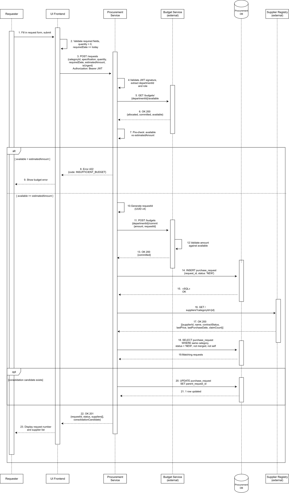

# Indirect Procurement Process — Requirements Package

A self-initiated business analysis case study. Not a client project and not a
test assignment — built to practise and demonstrate end-to-end requirements
work on a realistic corporate process.

**Sofia Karpenko** · [LinkedIn](https://www.linkedin.com/in/sofia-a-karpenko)

---

## The problem

A mid-sized company buys indirect goods and services — office equipment,
furniture, software licences, consumables — through departments acting
independently.

There is no single supplier registry, so each department searches on its own
and the same supplier is negotiated with several times over. Purchases are
fragmented: three departments order ten chairs each instead of one order for
thirty, and the company loses the volume discount. Budget availability is
checked manually, after the fact. A requester has no way to see the status of
their own request and resolves this by email and phone calls.

The package documents the current process, identifies the gaps, and specifies
a system that closes them.

---

## Contents

`Procurement_Requirements_Package.pdf` — the full package, 49 pages, with
bookmarks for navigation.

1. Context and Scope
2. Stakeholders
3. As-Is Process
4. Identified Problems
5. To-Be Process
6. Business Rules 
7. Functional Requirements
8. User Stories 
9. Data Model 
10. Integration Flow
11. API Contracts 
12. Non-Functional Requirements
13. Open Questions

---

## Diagrams

### As-is process

### To-be process

### Data model

### Create purchase request — integration flow

Source files are in the `diagrams` folder: `.bpmn` for the process models,
`.drawio` for the data model and the sequence diagram.

---

## Tools

Confluence · Jira · bpmn.io · draw.io · BPMN 2.0 · UML

The backlog was built in Jira: one epic, 15 stories, three sprints, each story
linked to the requirement it implements.
